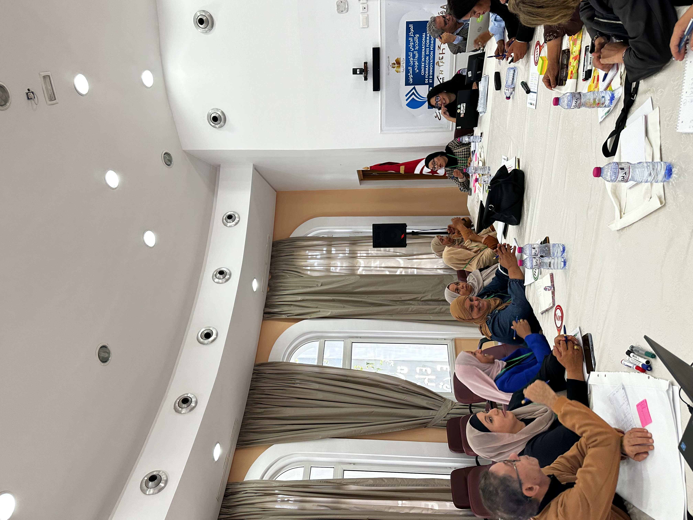
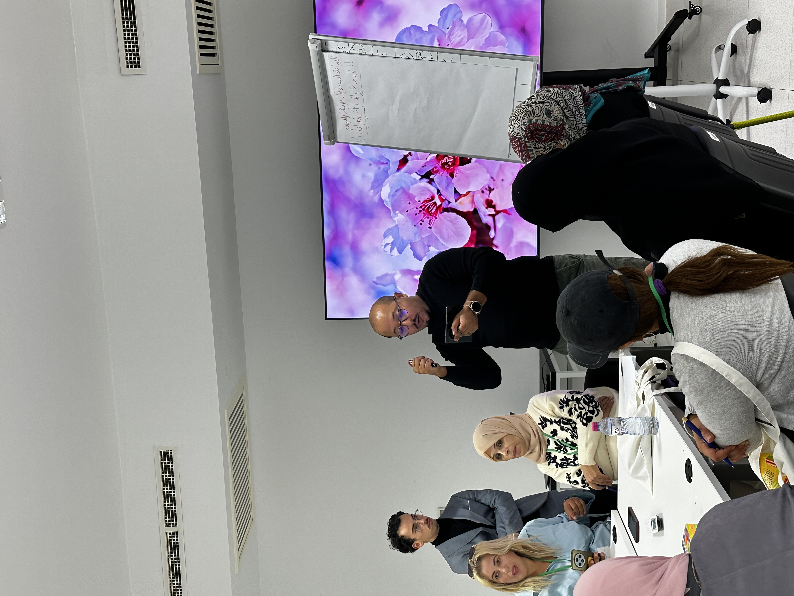
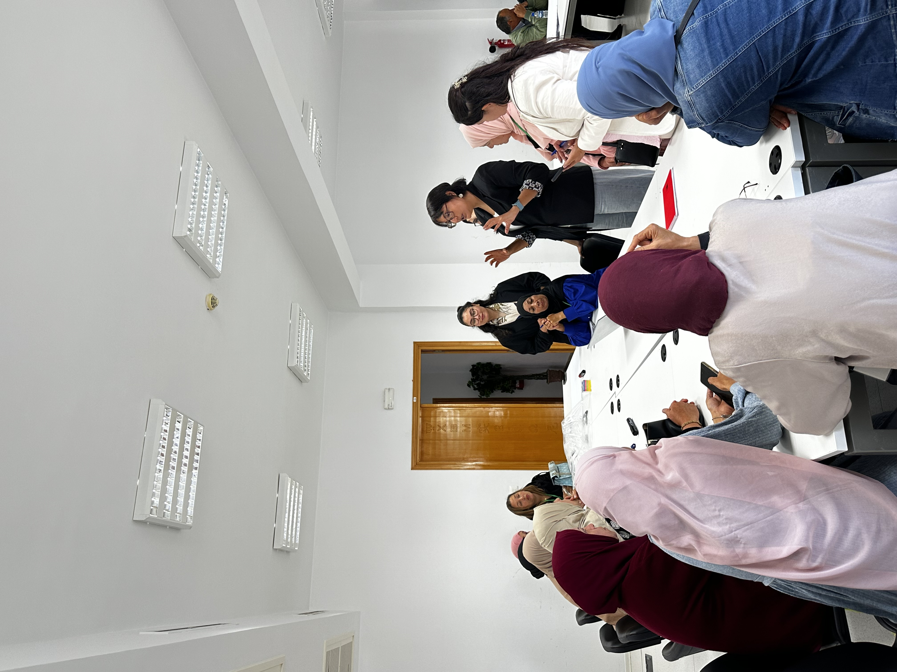

Les 9 et 10 novembre 2026, Shanti, en partenariat avec ICARDA, a organisé à Tunis une rencontre nationale consacrée au leadershi féminin dans les structures professionnelles agricoles. Pendant deux jours, des groupements, des SMSA, des institutions, des organisations d’appui et des chercheur·ses se sont réuni·es pour échanger et identifier des solutions concrètes visant à renforcer la voix, l’influence et l’inclusion des femmes dans la gouvernance des GDA.  

Cette rencontre s’inscrivait dans les actions de Shanti en faveur du développement territorial, de l’économie sociale et solidaire et de l’autonomisation économique des femmes.  

Malgré leur rôle central dans les structures professionnelles agricoles, les femmes restaient inégalement représentées dans les instances de gouvernance et les processus de décision. Cette rencontre nationale a ainsi constitué un espace d’échange entre femmes leaders, membres et travailleur·ses des GDA, OPA et SMSA, institutions publiques, organisations d’appui et chercheur·ses, afin d’analyser les facteurs favorisant ou limitant le leadership féminin et de formuler des recommandations adaptées au contexte tunisien. 

**Deux journées complémentaires** 

La première journée, qui a réuni 35 dirigeant·es, membres et travailleur·ses de structures professionnelles agricoles, s’est appuyée sur les résultats de la recherche pour recueillir directement les expériences du terrain. Les échanges ont porté sur les qualités d’un bon leadership, les parcours et les obstacles rencontrés par les femmes, la gouvernance, la transformation numérique, l’accès aux marchés et l’exclusion sociale. 

La deuxième journée, qui a rassemblé 40 représentant·es d’organisations et d’institutions travaillant auprès des GDA, a permis de traduire ces priorités en mesures de soutien institutionnel. 

Les participant·es ont cartographié les dispositifs d’appui existants, affiné les interventions retenues et élaboré de premières ébauches de plans d’action, assorties d’indicateurs et de mécanismes de suivi participatif.

**Une attention particulière à l’inclusion** 

Les travaux ont également porté sur les personnes les moins bien servies, notamment les femmes marginalisées, les jeunes, les travailleur·ses non-membres et, selon le contexte, les réfugié·es et les communautés d’accueil, afin d’améliorer leur accès à la participation, aux services et aux bénéfices. 

**Et ensuite ?** 

Cette rencontre sera suivie d’un second atelier au Kef, destiné à renforcer les capacités de membres de groupements agricoles sélectionnés et à favoriser l’adoption de pratiques de gouvernance plus participatives et inclusives, en s’appuyant sur les enseignements du dialogue national. Shanti assure la préparation méthodologique, la coordination et la facilitation participative des deux ateliers, ainsi que la capitalisation des résultats, en concertation avec ICARDA et l’INRAT.