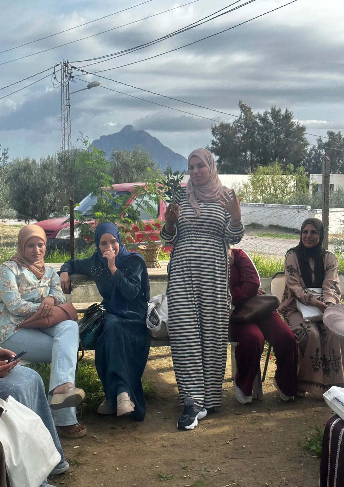
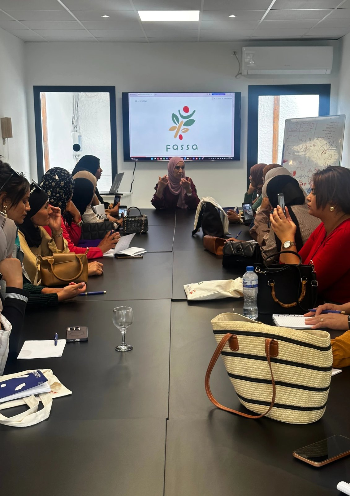
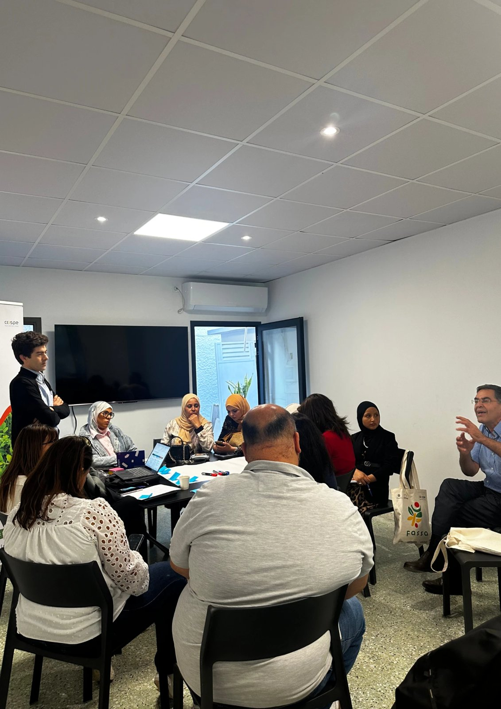

<!-- À VÉRIFIER :
- Titre modifié (ancien : « 24 ambassadrices de l’ESS en tournée d’inspiration ») : « inspiration » relève du vocabulaire que la charte écarte. À valider.
- Place des photos (plein air : Ben Arous ; salle : Tunis) déduite des images, à confirmer.
- Contenu des échanges à Ben Arous (gouvernance, coopération, valorisation) et de la session COSPE : tiré des cadres d’action, à confirmer.
- Auteure : Azza Malouche, coordinatrice de l’activité selon le cadre d’action. À confirmer.
-->

Les ambassadrices de l’économie sociale et solidaire (ESS) du projet FASSA sont 24, réparties entre Jendouba, Kairouan et Mahdia. Leur rôle est de promouvoir des initiatives d’ESS et d’animer des dynamiques collectives dans leurs territoires. SHANTI les accompagne, et une première série de sessions de formation a eu lieu dans chacune des trois régions.

Les 25 et 26 octobre, elles se sont retrouvées pour une rencontre interrégionale. Le programme reposait sur des visites et des témoignages : voir comment des groupements et des initiatives organisent concrètement leur coopération, et en discuter entre ambassadrices venues de territoires différents.

## Quatre groupements et une marque collective

La première journée s’est tenue à Ben Arous, avec Kounouz Ben Arous. Quatre groupements de développement agricole (GDA) y coopèrent autour d’une marque collective. Les présidentes et des membres des GDA ont présenté leur fonctionnement, et les échanges ont porté sur la gouvernance, la coopération entre les groupements et la valorisation de leurs produits.

Pour les ambassadrices, la question était de repérer ce qui, dans cette expérience, pourrait être repris à Jendouba, à Kairouan ou à Mahdia.

*Une prise de parole au milieu du cercle.*

*En visite, en plein air.*

## À Tunis

Le lendemain, la matinée a commencé chez SHANTI par une présentation de l’association, puis de Nahj El Collectif, une initiative distincte. Les ambassadrices ont ensuite visité L’artisanerie, SOGEMU et l’Espace Bahja.

*Présentation devant l’écran FASSA.*

L’après-midi, elles ont participé à une session organisée par COSPE avec SHANTI. Cette session préparait une conférence consacrée à l’inclusion financière, à l’autonomie économique des femmes et au leadership féminin. Des organisations de la société civile et des structures de microfinance y prenaient part, avec des expériences menées dans plusieurs pays. Réparti·es en trois groupes, les participant·es ont d’abord recensé les obstacles que rencontrent les femmes, d’ordre individuel et socioculturel, institutionnel ou économique. Ils et elles ont ensuite partagé des pratiques et des solutions, déjà éprouvées ou encore à l’état de proposition. La session devait aboutir aux questions à approfondir lors de la conférence.

*Travail en petit groupe, en salle.*

Côté SHANTI, la rencontre a été accompagnée par Jalel, chargé des dynamiques territoriales, et par Azza et Khouloud, chargées d’accompagnement.

---

*Le projet FASSA, AID 013244/06/6, est financé par le Ministère des Affaires Étrangères et de la Coopération Internationale (MAECI) à travers l’Agence Italienne pour la Coopération au Développement (AICS). Le projet est mis en œuvre par COSPE Maghreb en partenariat avec l’Association Tunisienne d’Agriculture Environnementale (ATAE), COOPERMONDO - Association pour la coopération internationale, l’association شانتي Shanti, et l’Union nationale de la femme tunisienne (UNFT).*
