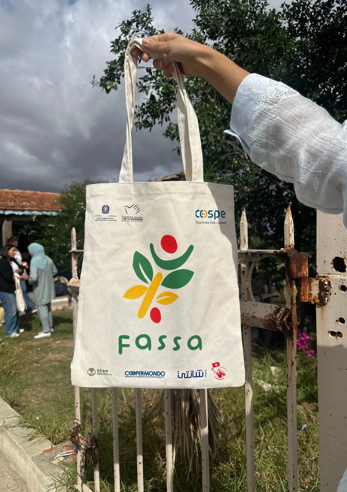

<!-- À VÉRIFIER :
- Photos envoyées par la coordination. Leur place dans le récit (plein air : jour 1 à Ben Arous ; salle : jour 2 chez SHANTI) est déduite des images, à confirmer. Droit à l’image à confirmer avant publication.
- Le détail du jour 1 (marque collective, témoignages) et de la session COSPE vient des cadres d’action : vérifier qu’il correspond à ce qui s’est fait.
- Auteure : Azza Malouche, coordinatrice de l’activité selon le cadre d’action. À confirmer.
-->

Elles viennent de Jendouba, de Kairouan et de Mahdia. Elles sont 24, et elles portent un même rôle dans leurs territoires : ambassadrices de l’économie sociale et solidaire (ESS). Les 25 et 26 octobre, elles ont quitté leurs régions pour deux jours à Ben Arous et à Tunis.

## Apprendre en regardant faire

Dans le cadre du projet FASSA, SHANTI accompagne ces ambassadrices dans leurs trois gouvernorats. Après les premières sessions régionales de formation, il manquait une chose : voir, de près, des initiatives qui fonctionnent. Cette rencontre interrégionale était faite pour ça. Découvrir des expériences concrètes, échanger entre pairs, et repartir avec des idées à adapter chez soi.

*Le sac FASSA, aux couleurs du projet et de ses partenaires.*

## Jour 1 : à Ben Arous, quatre GDA qui ont choisi de coopérer

La première journée s’est passée à Ben Arous, avec Kounouz Ben Arous. Derrière ce nom, quatre groupements de développement agricole (GDA) qui ont décidé de travailler ensemble, sous une marque collective.

Les présidentes et les membres des GDA ont raconté leur expérience : comment on coopère sans se perdre, comment on s’organise, comment on valorise ses produits à plusieurs. Pour des ambassadrices dont le rôle est justement de faire naître des dynamiques collectives, c’était un cas d’école, vu de l’intérieur.

*Une prise de parole au milieu du cercle.*

*En visite, en plein air.*

## Jour 2 : à Tunis, de SHANTI aux initiatives ESS

Le lendemain, rendez-vous chez SHANTI. La matinée a commencé par une présentation de l’association et de Nahj El Collectif, une initiative à part entière. Puis les ambassadrices sont parties à la découverte de trois lieux : L’artisanerie, SOGEMU et l’Espace Bahja.

*Présentation devant l’écran FASSA.*

L’après-midi a élargi encore l’horizon. COSPE et SHANTI organisaient une session de dialogue autour de l’inclusion financière, de l’autonomie économique des femmes et du leadership féminin. Les ambassadrices y ont pris part, avec des organisations venues de plusieurs pays. En petits groupes, chacun·e a d’abord identifié les obstacles qui freinent les femmes, individuels, institutionnels ou économiques, puis les pratiques et les solutions prometteuses.

*Travail en petit groupe, en salle.*

## Et après ?

Deux jours, trois territoires réunis, et des initiatives vues de l’intérieur. L’enjeu, maintenant : adapter ces pratiques à Jendouba, à Kairouan et à Mahdia.

L’équipe SHANTI les a accompagnées : Jalel, chargé des dynamiques territoriales, Azza et Khouloud, chargées d’accompagnement.

---

*Le projet FASSA, AID 013244/06/6, est financé par le Ministère des Affaires Étrangères et de la Coopération Internationale (MAECI) à travers l’Agence Italienne pour la Coopération au Développement (AICS). Le projet est mis en œuvre par COSPE Maghreb en partenariat avec l’Association Tunisienne d’Agriculture Environnementale (ATAE), COOPERMONDO - Association pour la coopération internationale, l’association شانتي Shanti, et l’Union nationale de la femme tunisienne (UNFT).*
