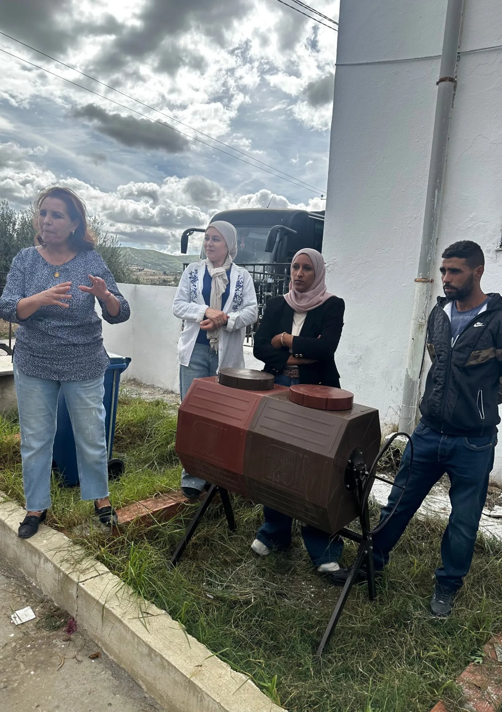

Dans trois régions de Tunisie, Jendouba, Kairouan et Mahdia, 24 femmes se sont engagées comme ambassadrices de l'économie sociale et solidaire (ESS). Sur le terrain, elles font connaître les initiatives existantes et encouragent le travail collectif autour d'elles. Avec l'appui de SHANTI, elles ont suivi une première série de formations dans chacune des trois régions, dans le cadre du projet FASSA.

Les 25 et 26 octobre, elles se sont retrouvées pour une rencontre interrégionale. Le programme reposait sur des visites et des témoignages : voir comment des groupements et des initiatives organisent concrètement leur coopération, et en discuter entre ambassadrices venues de territoires différents.

## Quatre groupements et une marque collective

La première journée s’est tenue à Ben Arous, avec Kounouz Ben Arous. Quatre groupements de développement agricole (GDA) y coopèrent autour d’une marque collective. Les présidentes et des membres des GDA ont présenté leur fonctionnement, et les échanges ont porté sur la gouvernance, la coopération entre les groupements et la valorisation de leurs produits.

Pour les ambassadrices, la question était de repérer ce qui, dans cette expérience, pourrait être repris à Jendouba, à Kairouan ou à Mahdia.

*Une prise de parole au milieu du cercle.*

*En visite, en plein air.*

## À Tunis

Le lendemain, la matinée a commencé chez SHANTI par une présentation de l’association. Les ambassadrices ont ensuite visité L’artisanerie, SOGEMU et l’Espace Bahja.

*Présentation de la coopérative Ideyeet Par Lamia.*

L’après-midi, elles ont participé à une session organisée par COSPE avec SHANTI. Cette session préparait une conférence consacrée à l’inclusion financière, à l’autonomie économique des femmes et au leadership féminin. Des organisations de la société civile et des structures de microfinance y prenaient part, avec des expériences menées dans plusieurs pays. Réparti·es en trois groupes, les participant·es ont d’abord recensé les obstacles que rencontrent les femmes, d’ordre individuel et socioculturel, institutionnel ou économique. Ils et elles ont ensuite partagé des pratiques et des solutions, déjà éprouvées ou encore à l’état de proposition. La session devait aboutir aux questions à approfondir lors de la conférence.

*Travail en petit groupe, en salle.*

---

