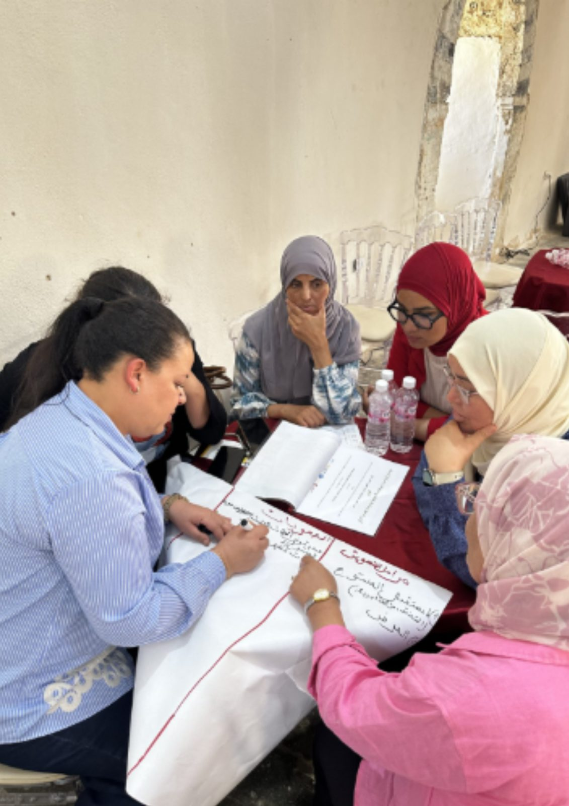

Le 15 octobre, c’est la Journée internationale des femmes rurales. Quelques jours plus tard, les 20 et 21 octobre, la Kasbah du Kef a accueilli **Signature Tounsiya**, deux journées pensées pour celles qui font vivre les territoires du Nord-Ouest : les femmes productrices et les groupements de développement agricole (GDA).

Autour d’elles, des partenaires locaux, des institutions publiques et des structures de financement. La rencontre était portée par le projet Taghyir GVA.

## Des savoir-faire, et des défis

Dans le Nord-Ouest, les femmes rurales et les GDA transforment et valorisent ce que le territoire produit : produits agroalimentaires, plantes aromatiques et médicinales, produits du terroir. Le potentiel est réel. Les obstacles aussi : la qualité et l’hygiène des produits, la structuration administrative et fiscale, l’accès aux marchés.

Signature Tounsiya est née pour ça : faire se rencontrer les productrices et tout l’écosystème qui peut les appuyer. Le nom lui-même dit l’intention. « Signature », en français, pour l’ouverture vers de nouveaux marchés. « Tounsiya », en arabe, pour l’attachement aux racines. Cette édition portait un sous-titre : *Femmes, territoires et résilience*.

*Prise de parole à la Kasbah du Kef.*

## Un panel inversé : elles parlent, la salle écoute

La première journée s’est ouverte sur un panel inversé. D’habitude, ce sont les expert·es qui parlent et les bénéficiaires qui écoutent. Ici, c’était l’inverse : les représentantes des GDA ont raconté leur parcours. Où elles en étaient avant l’accompagnement, ce qu’elles ont changé dans leurs pratiques, ce qui leur a été le plus utile, et ce dont elles ont besoin maintenant.

Le mécanisme TAGHYIR a ensuite présenté ses services aux GDA, dont la nouvelle unité de conditionnement du Kef.

## Vendre mieux, et vendre ensemble

L’après-midi, deux ateliers ont mis les mains dans le concret.

Le premier partait d’une question simple : *j’ai un bon produit, mais comment faire pour qu’il trouve son client ?* Qu’est-ce que je produis, pour qui, et pourquoi le choisirait-on plutôt qu’un autre ? Les participantes ont parlé origine, matière première locale, savoir-faire, mais aussi des conditions pour mettre un produit sur le marché : hygiène, conformité, emballage, étiquetage.

*Atelier en petits groupes, autour des grandes feuilles.*

Le second atelier portait sur l’intercoopération. Plusieurs GDA ont des produits différents, mais des difficultés communes. Que peuvent-ils mettre en commun sans perdre leur autonomie ? Un équipement, une commande, une action commerciale, une formation. L’idée : passer de « nous avons des problèmes similaires » à « nous pouvons construire une action ensemble ».

*Les idées s’écrivent à plusieurs mains.*

## Climat : les femmes au cœur de la résilience

La deuxième journée a pris de la hauteur : comment s’adapter et rester résilient·es face aux changements climatiques dans le Nord-Ouest ? Trois éclairages se sont succédé : les pratiques agricoles qui émergent face au climat dans la région, le lien entre genre et changements climatiques, et la Résolution 1325 des Nations Unies sur les femmes, la paix et la sécurité. Un long temps d’échange a suivi, pour que chacun·e partage ce qu’il ou elle vit sur son territoire.

Deux jours au Kef, avec un fil rouge : les femmes rurales, actrices du développement de leurs territoires.