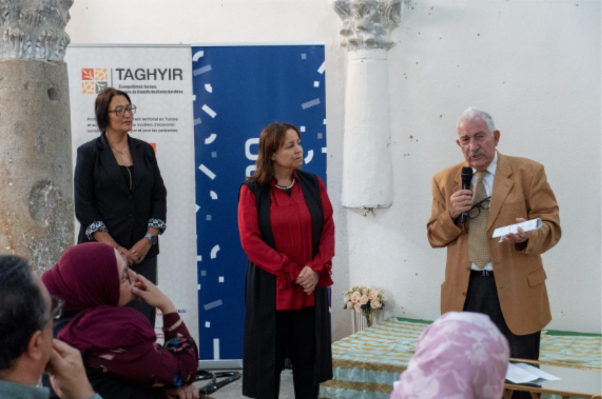
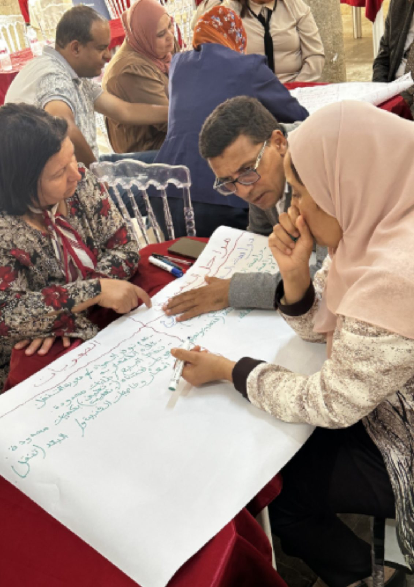

Dans le Nord-Ouest, des femmes rurales et des groupements de développement agricole (GDA) transforment et valorisent ce que produit leur territoire : produits agroalimentaires, plantes aromatiques et médicinales, produits du terroir. Les difficultés qu’elles rencontrent portent sur la qualité et l’hygiène des produits, la structuration administrative et fiscale, et l’accès aux marchés.

Ces questions étaient au centre de Signature Tounsiya, organisée les 20 et 21 octobre à la Kasbah du Kef dans le cadre du projet Taghyir GVA, quelques jours après la Journée internationale des femmes rurales du 15 octobre. Les GDA y ont retrouvé des partenaires locaux, des institutions publiques et des structures de financement. Signature Tounsiya est le nom commun d’une série de rencontres consacrées aux initiatives locales et aux produits du terroir ; celle du Kef portait le sous-titre *Femmes, territoires et résilience*.

*Prise de parole à la Kasbah du Kef.*

## Un panel inversé

La première journée s’est ouverte sur un panel inversé. La parole y était donnée d’abord aux représentantes des GDA. Elles ont décrit leur situation avant l’accompagnement, ce qu’elles ont modifié dans leurs pratiques, et ce dont elles ont encore besoin pour passer à l’étape suivante. Le mécanisme TAGHYIR a ensuite présenté ses services aux GDA, dont la nouvelle unité de conditionnement du Kef.

## Vendre, et coopérer entre groupements

L’après-midi était consacré à deux ateliers. Le premier partait d’une question simple : *j’ai un bon produit, mais comment faire pour qu’il trouve son client ?* Les participantes ont travaillé sur ce qui distingue leurs produits (origine, matière première locale, savoir-faire), puis sur les conditions de leur mise sur le marché : hygiène, conformité, emballage et étiquetage.

*Atelier en petits groupes, autour des grandes feuilles.*

Le second atelier portait sur l’intercoopération. Des GDA aux produits différents rencontrent souvent les mêmes difficultés. Les groupes ont cherché ce qu’ils pourraient mettre en commun sans perdre leur autonomie : un équipement, une commande groupée, une action commerciale, une formation. L’atelier visait à faire passer les participantes du constat de problèmes partagés à une première idée d’action commune.

*Un autre groupe de travail.*

## Agriculture, genre et climat

La seconde journée portait sur l’adaptation aux changements climatiques dans le Nord-Ouest. Trois interventions se sont succédé : les pratiques agricoles qui se développent dans la région face au climat, les liens entre genre et changements climatiques, puis la Résolution 1325 du Conseil de sécurité des Nations Unies sur les femmes, la paix et la sécurité. Un temps de discussion a suivi, pour que les participant·es partagent ce qu’ils et elles observent sur leur territoire.