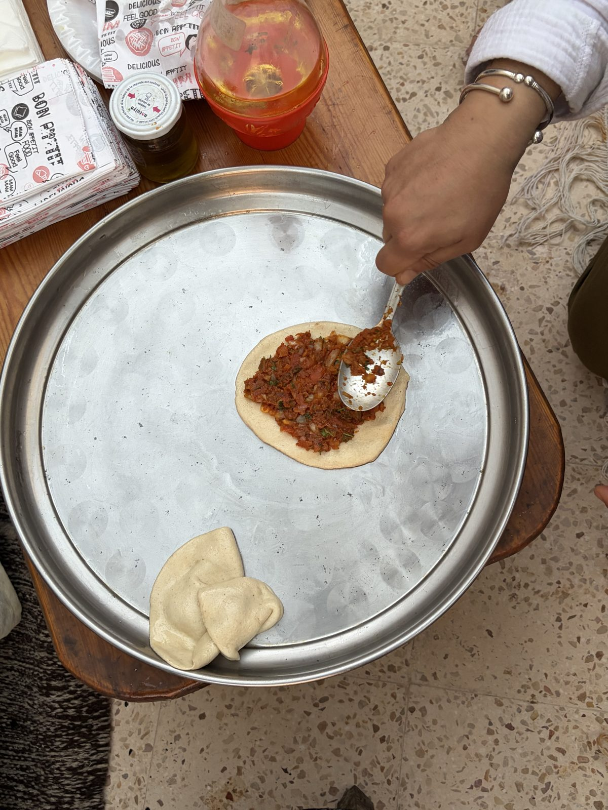

Il y a des maisons qui s’ouvrent doucement. Le 14 novembre 2026, à Nefta, Dar el Mensej a accueilli du public pour la première fois. 25 visiteurs et visiteuses sont venu·es passer un moment avec les artisanes, chez elles.

## Une maison à elles

Dar el Mensej est un nouvel espace SHANTI à Nefta, pensé pour les artisanes et géré par elles. Ce n’est pas seulement un atelier. On y tisse, on y cuisine, on y vit ensemble. Ce premier atelier ouvert au public était une façon de partager ce lieu, et ce qui s’y fait.

*Le métier à tisser, au cœur de la maison.*

## Le fil, d’abord

L’atelier a commencé par le tissage. Une artisane d’El Mensej s’est installée au métier, et le public s’est rassemblé autour d’elle : on regarde le geste, on photographie, on filme.

## Goûter, ensuite

En parallèle, un autre atelier se tenait : la mtabga. Chacun·e pouvait mettre la main à la pâte, puis goûter le résultat. Une autre façon d’entrer dans la maison, par la cuisine.

*Atelier mtabga.*

## Et pour finir, un jeu

La journée s’est terminée par un jeu de sig, qui se joue avec des tiges de palmier.

## Une équipe pour ouvrir la porte

Lina a coordonné l’atelier. Bassem et Fatma l’ont organisé. Les artisanes d’El Mensej et les cheffes de la table d’hôte In Nefta l’ont fait vivre.

Dar el Mensej a ouvert sa porte au public pour la première fois.