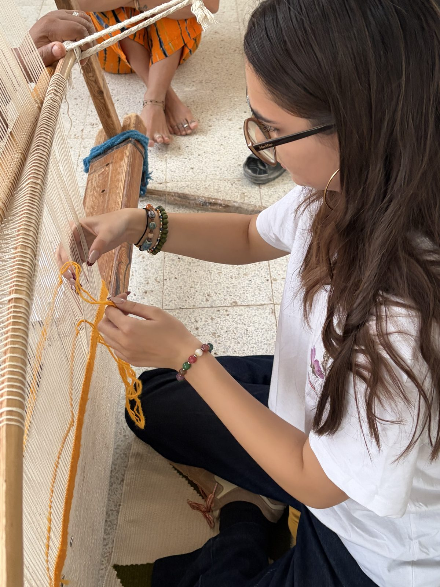

Dar el Mensej est un nouvel espace SHANTI à Nefta, pensé pour les artisanes et géré par elles. Elles y tissent, y cuisinent et y passent du temps ensemble. Le 14 novembre 2026, le lieu a accueilli du public pour la première fois : 25 visiteurs et visiteuses sont venu·es pour un atelier animé par les artisanes d’El Mensej et les cheffes de la table d’hôte In Nefta.

*Un métier à tisser, à Dar el Mensej.*

L’atelier a commencé par le tissage. Une artisane d’El Mensej a travaillé au métier pendant que le public regardait, prenait des photos et filmait. En parallèle se tenait un atelier de mtabga, où chacun·e pouvait essayer, puis goûter.

*Atelier mtabga.*

La journée s’est terminée par un jeu de sig, qui se joue avec des tiges de palmier.

Lina a coordonné l’atelier, Bassem et Fatma l’ont organisé.
