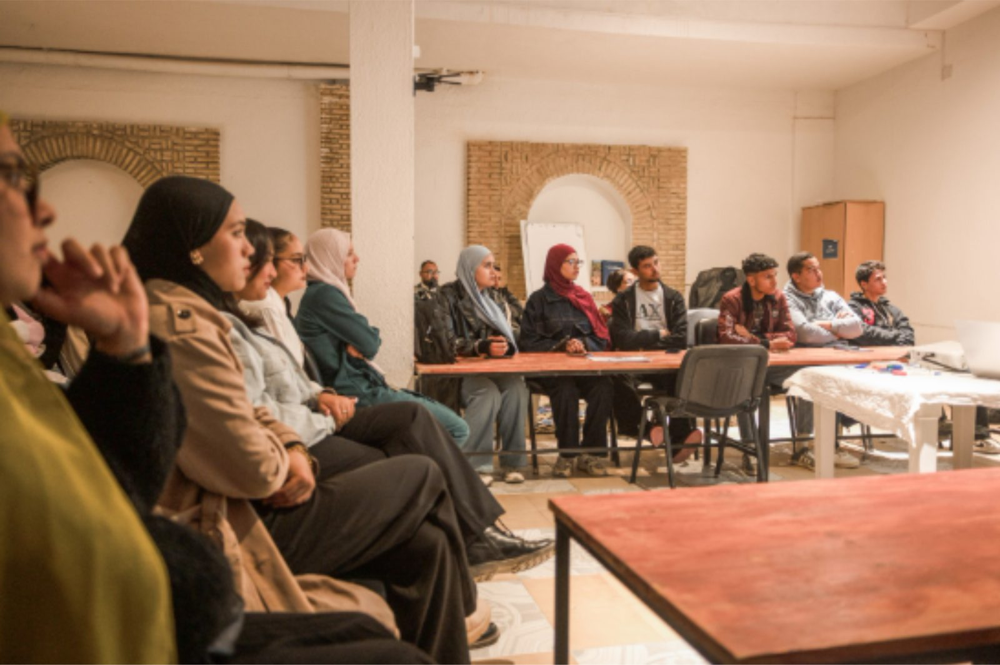

Cinq minutes pour convaincre, cinq minutes pour répondre aux questions. Le 18 octobre à Shanti - Tunis, les jeunes du programme YES-Med ont présenté, chacun·e à leur tour, leur projet d'entrepreneuriat social et durable. Ce pitch fermait un mois de formation commencé le 19 septembre.

## Un programme, six pays

YES-Med est un programme Erasmus+ qui réunit six pays autour de la Méditerranée : l'Italie, la France, l'Espagne, la Tunisie, le Maroc et le Liban. Il s'adresse aux jeunes de 18 à 35 ans, avec une ambition commune : développer leurs compétences, partager leurs expériences et passer à l'action dans leurs territoires, au service de l'économie sociale et solidaire.

En Tunisie, 24 jeunes ont été sélectionné·es.

## De l'idée au modèle économique

La formation alternait en ligne et présentiel. Elle a démarré le 19 septembre par une session à distance, puis s'est poursuivie dans les locaux de SHANTI, en deux temps, début et mi-octobre.

*Dans la salle de formation, chez SHANTI.*

Six modules pour faire grandir une idée, étape par étape :

1. comprendre les enjeux et les opportunités de son territoire ;
2. concevoir une initiative inclusive d'ESS ;
3. construire un modèle viable et inclusif ;
4. planifier et mobiliser les ressources nécessaires ;
5. mobiliser les parties prenantes et communiquer ;
6. assurer la durabilité et mesurer l'impact.

Le but n'était pas d'accumuler de la théorie. Il fallait développer des compétences numériques, environnementales et entrepreneuriales, renforcer son employabilité, et surtout repartir avec une idée de projet et un modèle économique finalisé.

## Et maintenant ?

Le pitch du 18 octobre n'était pas une fin. Dans YES-Med, la formation est le socle de la suite : chaque participant·e est appelé·e à concevoir une action pilote dans son territoire, avec l'accompagnement de SHANTI. La sélection sera annoncée dans les prochaines semaines.