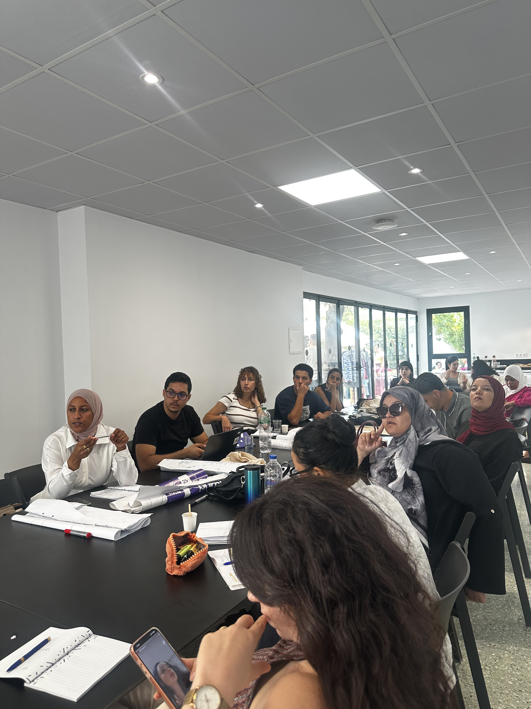
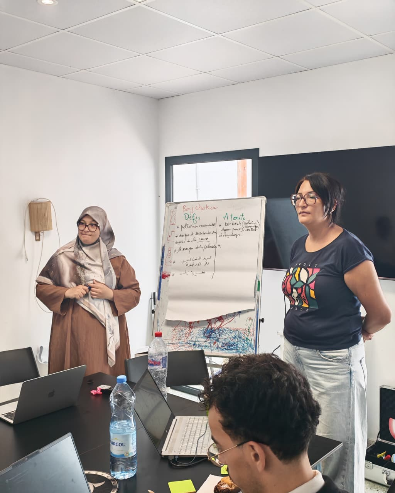

Cinq minutes pour présenter son projet, cinq minutes pour répondre aux questions. Le 18 octobre, à Shanti - Tunis, les jeunes du programme YES-Med ont présenté tour à tour leur projet d’entrepreneuriat social et durable. Ce pitch clôturait la formation commencée le 19 septembre.

YES-Med est un programme Erasmus+ qui réunit six pays de la Méditerranée : l’Italie, la France, l’Espagne, la Tunisie, le Maroc et le Liban. Il s’adresse aux jeunes de 18 à 35 ans et vise à développer leurs compétences, puis à les accompagner dans des actions concrètes sur leur territoire, dans le champ de l’économie sociale et solidaire. En Tunisie, 24 jeunes ont été sélectionné·es.

## Le parcours

La formation a démarré en ligne le 19 septembre, puis s’est poursuivie en présentiel dans les locaux de SHANTI, en deux temps, début et mi-octobre. Elle visait à développer des compétences numériques, environnementales et entrepreneuriales, avec un objectif précis : que chaque participant·e termine avec une idée de projet et un modèle économique finalisé.

*Dans la salle de formation, chez SHANTI.*

Les six modules suivaient la construction d’un projet, de l’analyse du territoire jusqu’à la mesure de son impact :

1. comprendre les enjeux et les opportunités de son territoire ;
2. concevoir une initiative inclusive d’ESS ;
3. construire un modèle viable et inclusif ;
4. planifier et mobiliser les ressources nécessaires ;
5. mobiliser les parties prenantes et communiquer ;
6. assurer la durabilité et mesurer l’impact.

## La suite

Dans YES-Med, la formation prépare l’étape suivante : chaque participant·e est appelé·e à concevoir une action pilote dans son territoire, avec l’accompagnement technique de SHANTI. 

La sélection sera annoncée dans les prochaines semaines.