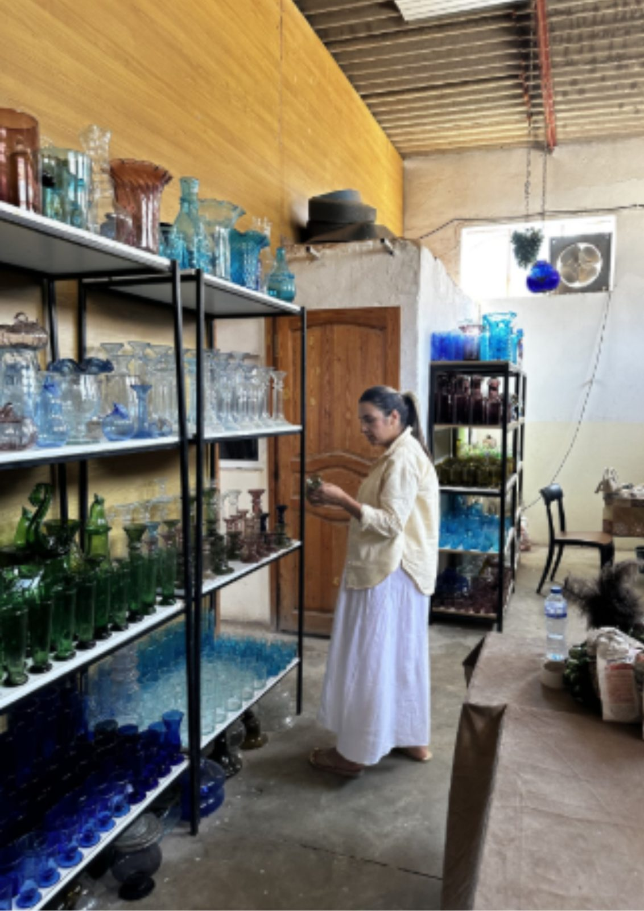
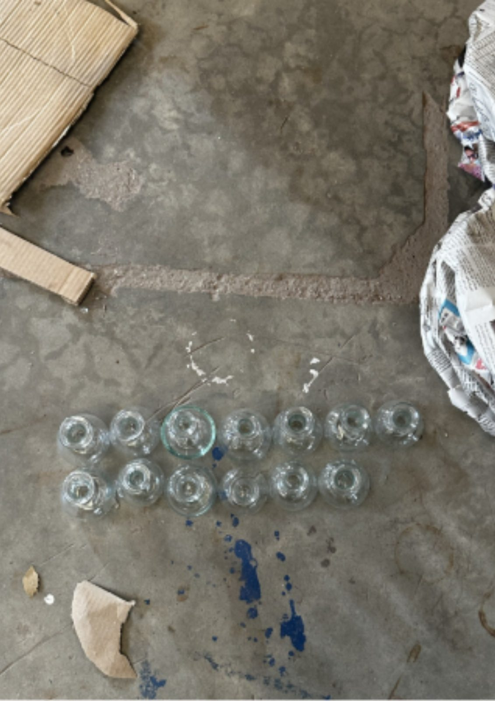
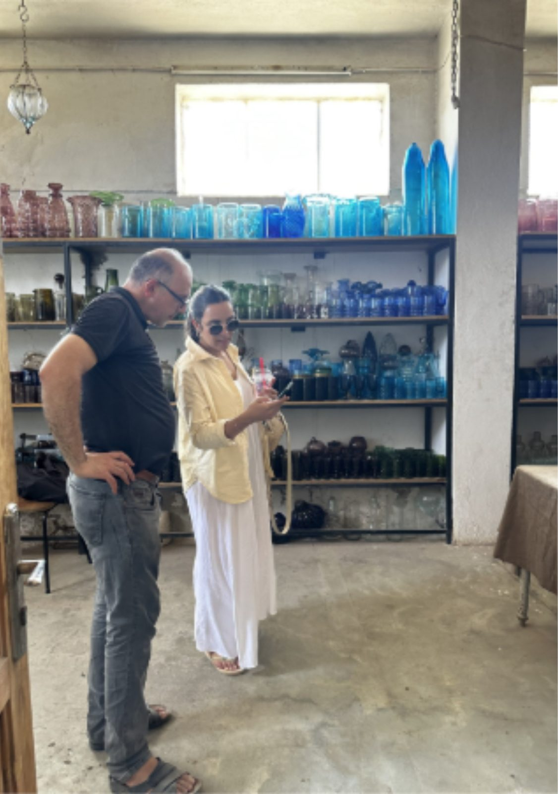

<!-- À VÉRIFIER :
- La fiche 11 est vide ; l’article s’appuie sur la fiche 4 (conception, verre soufflé), sur le contexte de la fiche 10 et sur le cadre d’action du shooting de la collection. La liste des produits par région vient de ce cadre d’action : à confirmer pour la collection finale.
- Lancement : la fiche 10 annonce le lancement lors de Nahj el Collectif le 21 novembre. Confirmer qu’il a bien eu lieu ce jour-là, et sous quelle forme.
- Région : la fiche indique « Grand Tunis » (lieu du lancement). Les ateliers sont dans cinq régions, dont Nabeul.
- Les produits de Sejnane ne sont pas précisés dans les sources.
-->

Pour concevoir la collection Automne-Hiver 2026 de L’artisanerie, le pôle artisanat de SHANTI s’est déplacé dans les ateliers, aux côtés des artisan·es. Les pièces viennent de cinq régions : le Jérid, la Kroumirie, Sejnane, le Cap-Bon et Tunis.

## Dans l’atelier de verre soufflé

À Nabeul, Amal, coordinatrice du pôle artisanat, accompagnée de Molka, chargée de communication, a travaillé avec l’artisan verrier Omar Kazez. Les idées et les formes y ont été discutées ensemble, les matières choisies ensemble. Est venue ensuite l’étape du prototypage : chaque pièce a été testée, ajustée et affinée avec l’artisan.

*Dans la réserve de l’atelier, parmi les pièces de verre.*

*Pièces de verre posées au sol de l’atelier.*

## La table et le salon

La collection s’organise autour de deux univers. Pour la table : nappes, serviettes et sets brodés à Tunis, sets de table et dessous de verre tissés à Nefta, vaisselle en poterie d’Aïn Draham et en verre soufflé de Nabeul. Pour le salon : fauteuil, tabouret, banc et marfaa en bois de palmier de Nefta, coussins de Tunis, petits tableaux d’Aïn Draham, kilims et plaids de Nefta. De petits accessoires sont prévus pour des coffrets cadeaux de fin d’année.

*Dans l’atelier de verre soufflé, à Nabeul.*

La collection a été lancée le 21 novembre, à Tunis, pendant la journée Nahj el Collectif · صنايعي.
