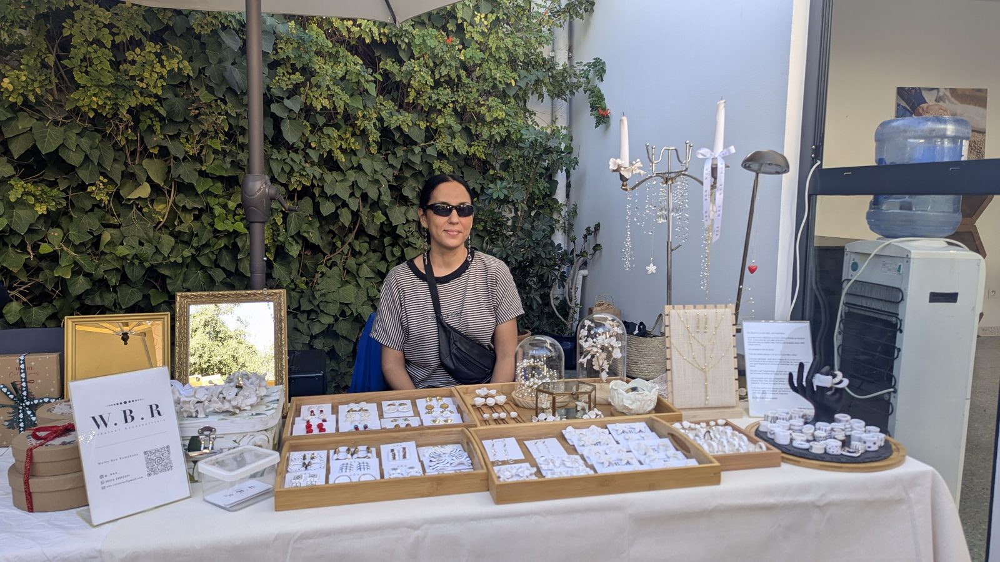
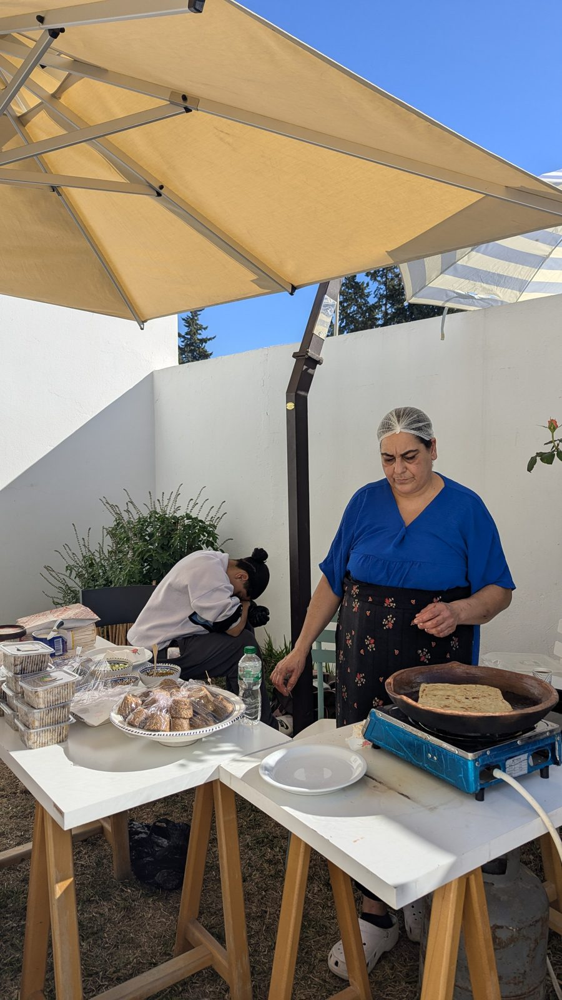

Nahj el Collectif s’est construit autour de la rue du Niger, à Tunis, entre plusieurs structures qui partagent des espaces, des ressources et des événements. 

Le 21 novembre, le collectif a organisé une nouvelle journée, Nahj el Collectif · صنايعي, avec Collectif Créatif, l’ATP et L’artisanerie. La journée mettait l’accent sur le design, l’artisanat et le développement durable. 

*Stands des créateurs.rices*

*Cuisine préparée sur place.*

La journée célébrait le lancement de la collection Automne-Hiver 2026 de L’artisanerie, avec un nouvel aménagement de la boutique pensé pour une immersion dans les univers du salon et de l'art de la table.   
  
à très vite dans la rue du Niger !