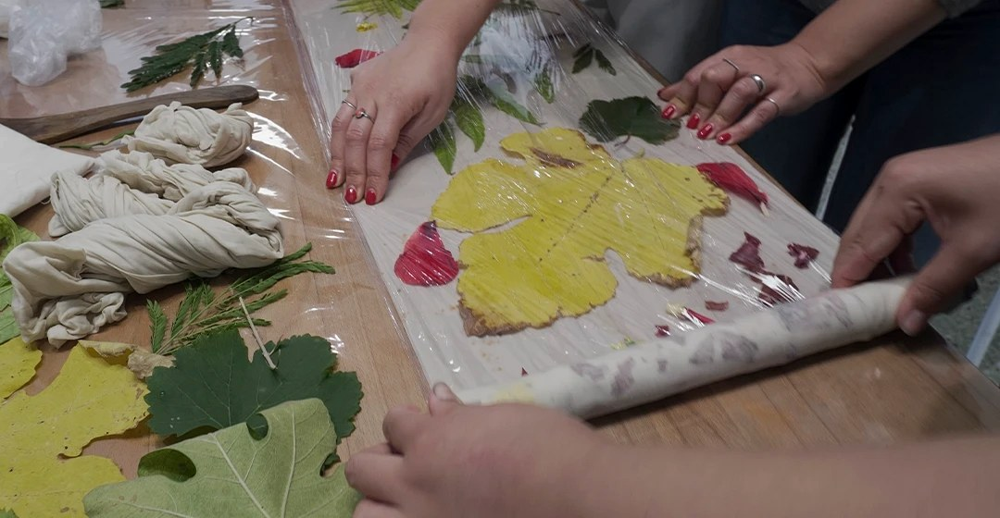
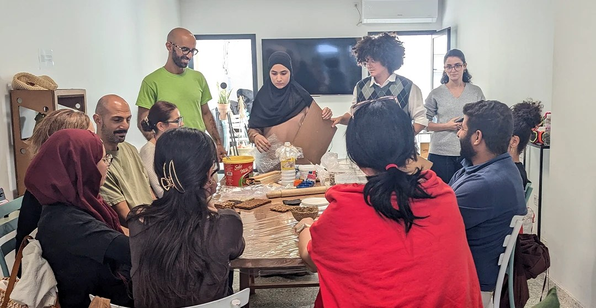
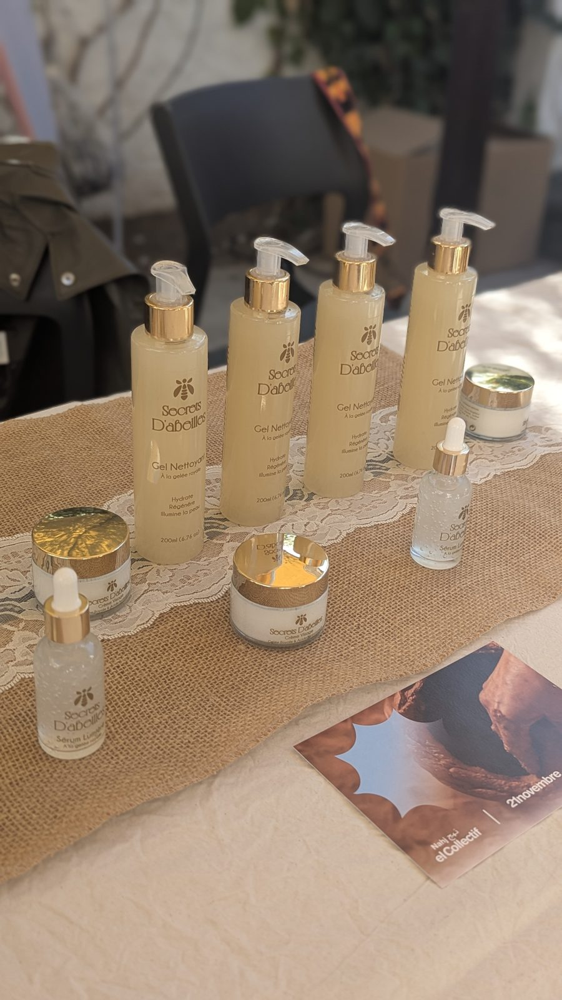

Nahj el Collectif s’est construit autour de la rue du Niger, à Tunis, entre plusieurs structures qui partagent des espaces, des ressources et des événements.

Le 21 novembre, le collectif a organisé son édition d’automne, Nahj el Collectif · صنايعي, avec Collectif Créatif, l’ATP et L’artisanerie. Les صنايعية, ce sont celles et ceux qui fabriquent : artisan·es, designers, producteur·rices. La journée mettait l’accent sur le design, l’artisanat et le développement durable, de 10 h à 18 h, aux 44 et 46 rue du Niger, à Montplaisir.

## Les ateliers

Collectif Créatif a animé trois ateliers ouverts au public. En sérigraphie, avec Mohamed, chacun·e pouvait apporter un t-shirt en coton et y imprimer un motif choisi parmi plusieurs graphismes. L’atelier d’ecoprint, avec Nada, consistait à imprimer des motifs à partir de plantes. L’après-midi, Habiba et Emna ont proposé de fabriquer de petits objets à partir de déchets alimentaires secs, en expérimentant avec des fibres locales et des biomatériaux.

*Atelier ecoprint : feuilles et pétales sont disposés sur le tissu, puis roulés.*

*Atelier biomatériaux, l’après-midi.*

Tout au long de la journée, l’espace du Collectif Créatif a accueilli des échanges spontanés autour de l’artisanat et du design.

## Le marché

Dans la cour, un marché paysan et créatif se tenait toute la journée. L’ATP y proposait des fruits et légumes de saison, cultivés sans intrants chimiques ni pesticides. Autour, des producteur·rices et des créateur·rices présentaient leurs produits : bougies, encens, objets de décoration, huiles et soins naturels.

*Stands des créateurs.rices*

# Nouvelle collection L'artisanerie

La journée célébrait le lancement de la collection Automne-Hiver 2026 de L’artisanerie, avec un nouvel aménagement de la boutique pensé pour une immersion dans les univers du salon et de l’art de la table.

À très vite dans la rue du Niger !