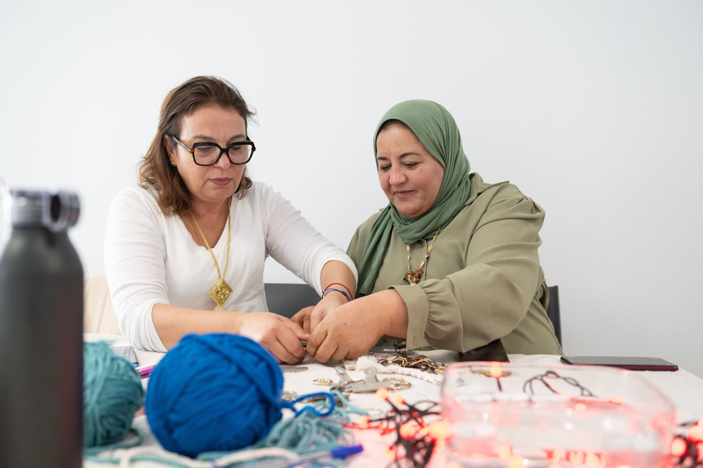

Avec le projet SUMUD, SHANTI et ses partenaires ont accompagné des entreprises artisanales, agricoles et touristiques autour de trois axes : la résilience, l’innovation et la durabilité. Deux journées ont marqué la fin de cet accompagnement. La première, ouverte au public et organisée par SHANTI, présentait les initiatives, les savoir-faire et les parcours des entreprises accompagnées.

## Signature Tounsiya, rue du Niger

Le 15 novembre, les espaces des 44 et 46 rue du Niger, à Tunis, ont accueilli **Signature Tounsiya**, sous la forme d’un « village SUMUD ». Une vingtaine d’entreprises artisanales, agricoles et touristiques accompagnées par le projet y présentaient au public leurs produits et leurs savoir-faire.

Le village s’organisait en trois espaces. Le premier réunissait les stands, où les entreprises exposaient et vendaient leurs créations artisanales et leurs produits du terroir, avec un espace de dégustation.

*Sacs et bijoux brodés présentés par une entreprise accompagnée.*

Le deuxième accueillait des ateliers pratiques ouverts à toutes et à tous. Les visiteur·ses pouvaient s’y initier à des savoir-faire artisanaux et voir comment sont fabriqués les produits présentés sur les stands. L’idée était de mettre le public en contact direct avec les entreprises et leurs métiers.

*Un atelier pratique, pendant la journée.*

Le troisième était consacré au tourisme. En Tunisie, le tourisme de masse occupe une grande place ; les entreprises accompagnées par SUMUD proposent d’autres façons de découvrir le pays. Elles y présentaient des offres de tourisme durable et culturel, ancrées dans les régions et dans leurs ressources locales.

La journée visait à mettre en relation les entreprises accompagnées, le public et les acteurs intéressés par les initiatives locales. Elle montrait la diversité des parcours des entreprises et celle de l’accompagnement proposé par SUMUD, selon les territoires et les secteurs : artisanat, agriculture, tourisme.

Le lendemain, 16 novembre, la journée officielle de clôture, organisée par OXFAM, réunissait les partenaires, les bailleurs et des représentant·es des ministères.