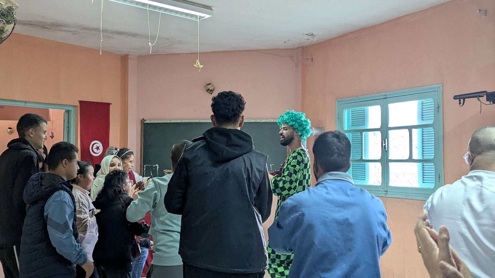

<!-- À VÉRIFIER :
- Thème : la fiche n’en indique pas. « Événement » retenu (type d’activité de la fiche). À valider.
- Orthographe : la fiche écrit « Trail’elle », le rapport « Trai’ELLE ». L’article retient « Trai’ELLE ».
- Sources : rapport « Rapport Trai’ELLE – édition 2026 » (pôle RDC). Plusieurs sections de ce rapport sont encore à compléter (participant·es par activité, contenu de la table ronde et de l’atelier agro-écologie) : ces éléments ne sont pas repris.
- Photos : la photo principale (sous la tente) est prise le 30 octobre au matin, sans précision dans le rapport sur l’activité concernée. La seconde est datée du 30 octobre après-midi, ce qui correspond à la rencontre à l’AGIM : à confirmer.
-->

Trai’ELLE est d’abord une course : 18,4 km réservés aux femmes, à travers les forêts de chênes-lièges et de pins, d’Aïn Draham à Aïn Saïda. Le 1er novembre, 77 coureuses ont pris le départ. Créé en 2023 par Dar El Ain, une agence d’écotourisme de Tabarka, l’événement s’accompagne de trois jours d’activités sportives, culturelles, agro-écologiques et solidaires, réparties cette année entre trois éco-villages : Aïn Draham, Babouch et Aïn Saïda. La 4e édition s’est tenue en partenariat officiel avec le projet Maghroum’IN, du programme EU4Youth de l’Union européenne.

SHANTI, déjà partenaire en 2025, y a participé dans le cadre de son mécanisme territorial d’Aïn Draham, qui accompagne notamment des groupements de femmes rurales (GDA), des artisan·es et des jeunes du territoire. L’enjeu était de donner aux femmes et aux groupements accompagnés un espace de vente et de visibilité, et d’ouvrir des temps d’échange sur l’économie sociale et solidaire, l’agro-écologie et le développement local.

## Un marché et des ateliers

Le 30 et le 31 octobre, le centre-ville d’Aïn Draham a accueilli un marché solidaire, co-animé par le WWF Afrique du Nord, l’association AIDE et SHANTI, qui y tenait un stand. Productrices, artisan·es et groupements du territoire y présentaient produits du terroir et artisanat, devant un public venu en partie d’autres régions pour la course.

Le 30 octobre en fin de journée, SHANTI et l’association AIDE ont proposé sur la placette des ateliers d’initiation au tissage et à la poterie, encadrés par des artisan·es du territoire, ainsi que des jeux en bois pour les enfants. Plus tôt, SHANTI avait appuyé Ainna Hub dans l’organisation d’une table ronde sur l’artisanat et le développement local.

## Deux espaces de parole

Le 31 octobre, à la Maison des jeunes El Ezdihar, SHANTI a co-animé deux temps d’échange. Le premier, « Om w Bou ija nahkiw » (« Maman, papa, venez, on parle »), a réuni des membres de cinq GDA du territoire (Ghdir, Tbainia, Dar Fatma, Aïn Saïda et Douar Ncham) et des jeunes, autour du témoignage et de l’échange entre générations, plutôt que d’interventions d’expert·es. Le second, le focus group CampDev, a réuni des élèves de trois établissements du Nord-Ouest. Les sports de montagne servaient de point de départ pour parler de leur région : ce qui en fait la valeur, et ce qui freine sa mise en valeur.

Le même jour, à Babouch, SHANTI animait à la ferme pédagogique Green Village, avec SVR, un atelier sur les initiatives locales qui associent agro-écologie et économie sociale et solidaire.

## Des jeunes de Nefta à Aïn Draham

Du 29 octobre au 1er novembre, un groupe de jeunes en situation de handicap de l’association Abou Ali Essouni, partenaire du mécanisme de SHANTI à Nefta, a participé à l’événement. Le 30 octobre, l’AGIM d’Aïn Draham les a reçus pour une rencontre avec des jeunes du territoire : fresque collective « Entre désert et montagne », jeux coopératifs en équipes mixtes, puis un temps où les jeunes ont proposé des idées pour de prochaines activités communes. La rencontre s’est conclue par la signature d’une convention de partenariat entre l’AGIM et l’association Abou Ali Essouni. Le groupe a ensuite pris part à un atelier de poterie avec l’association AIDE et le Centre international de promotion des personnes handicapées de Tabarka, puis aux jeux sur la biodiversité animés par le WWF le jour de la course.

*Animation pendant la rencontre à l’AGIM d’Aïn Draham.*

Le bilan de l’équipe relève les limites de cette édition. Le 31 octobre, SHANTI portait quatre activités sur deux sites, et le déroulement en parallèle a réparti le public entre plusieurs lieux. Les formats courts, d’une heure à deux heures et demie, laissaient peu de temps pour approfondir. L’équipe en retient que les ateliers pratiques et les temps de témoignage conviennent mieux à un public de passage que des présentations formelles, et que l’événement permet d’identifier de nouveaux contacts (artisan·es, jeunes, partenaires), à condition d’en organiser le suivi ensuite avec le mécanisme d’Aïn Draham.
